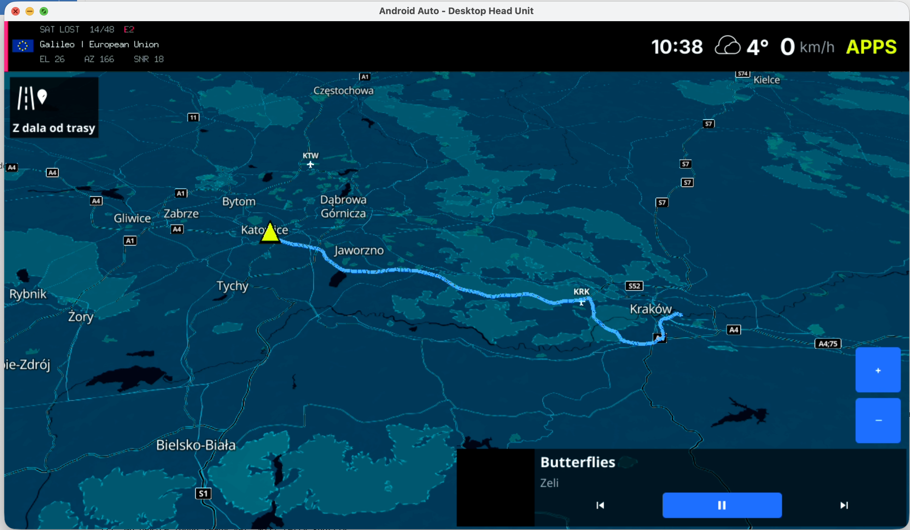
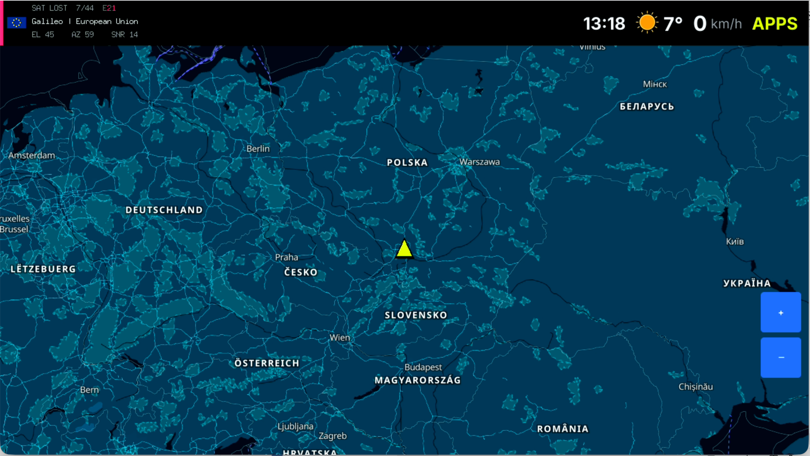
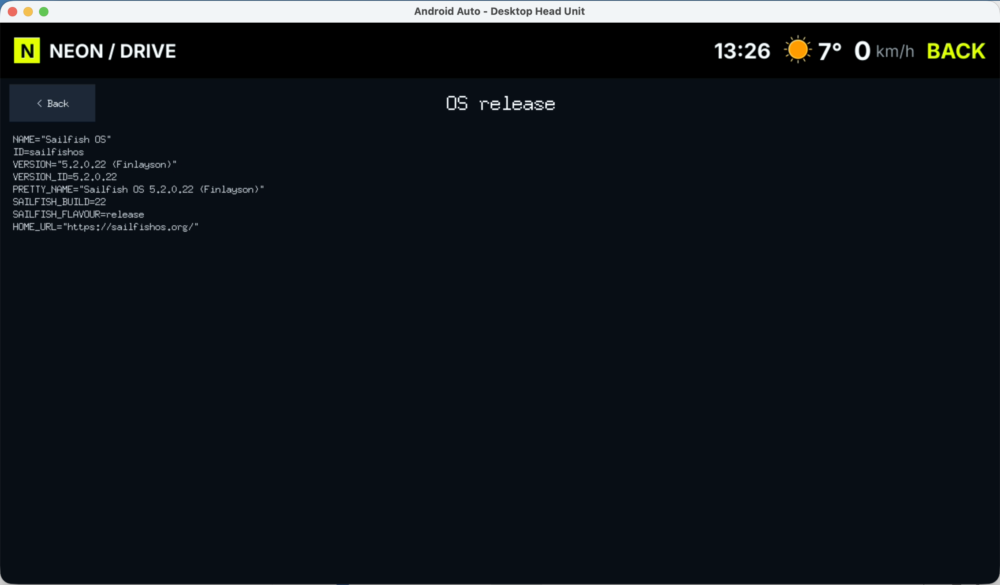
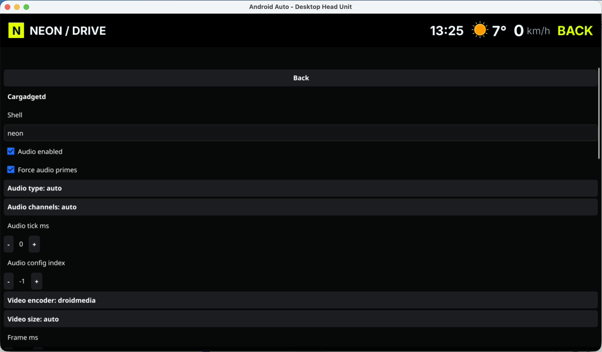
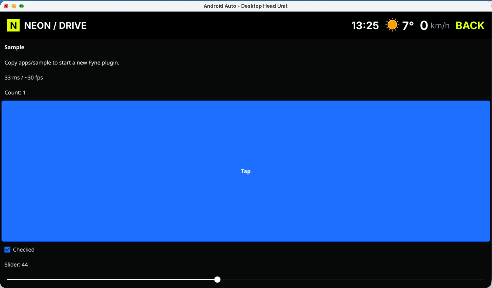

# Cargadgetd neon shell

Drive chrome, app launcher, and on-screen log for cargadgetd. The shell id is `neon`. The library is `libcargadgetd_shell_neon.so`.

The drive view composites maps, music, area, and sats. `shell.id` stays `basic` until it is set to `neon`.

Looking for cargadgetd? [Click here to go to main project repo](https://github.com/mrcyjanek/cargadgetd)

## Screenshots




|  | |
|:-:|:-:|
|  |  |
|  |  |

Apps visible above:

- [Maps](https://github.com/MrCyjaneK/cargadgetd_app_maps)
- [Shells](https://github.com/MrCyjaneK/cargadgetd_app_shells)
- [Settings](https://github.com/MrCyjaneK/cargadgetd_app_settings)
- [Sats](https://github.com/MrCyjaneK/cargadgetd_app_sats)

```bash
sfosbuild 5.1.0.11 aarch64 ./rpm/cargadgetd-shell-neon.spec
```
